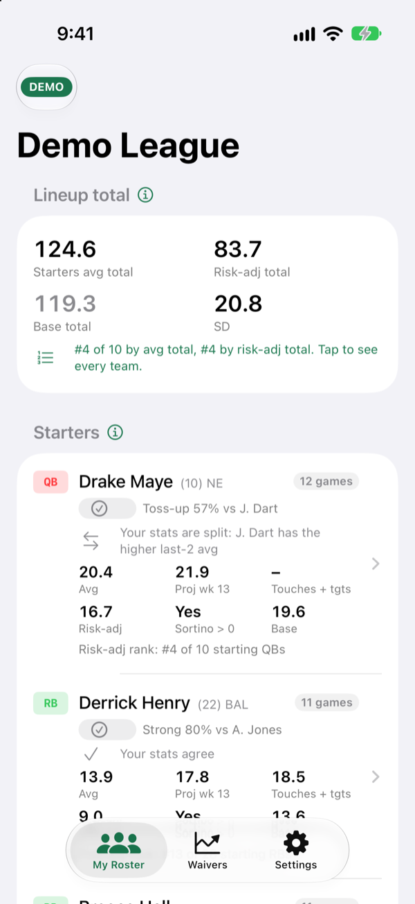
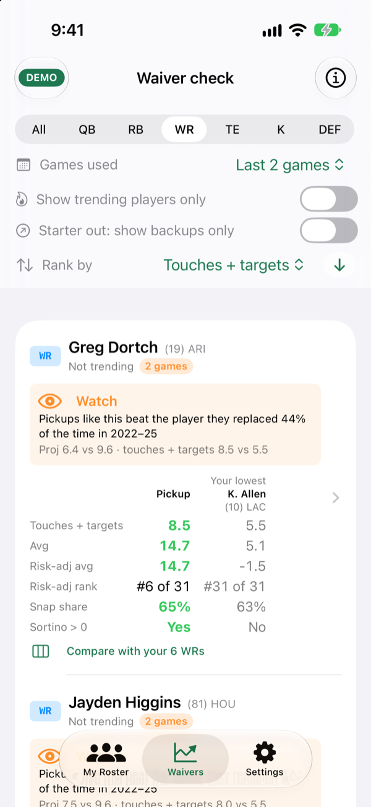
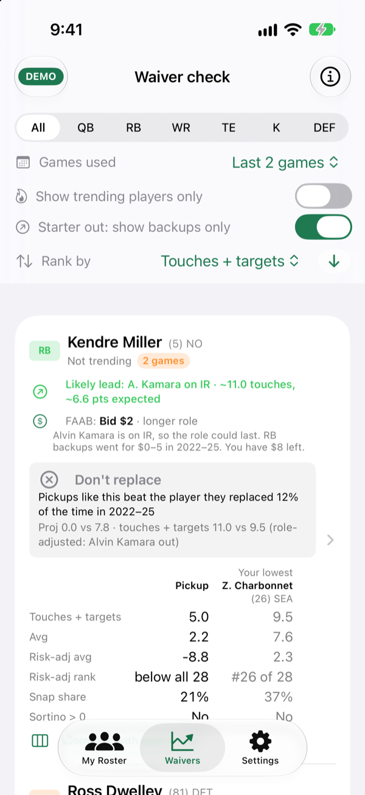
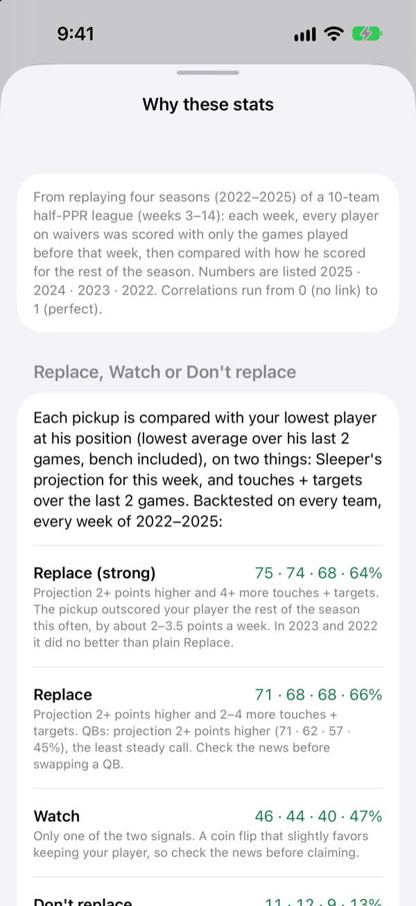
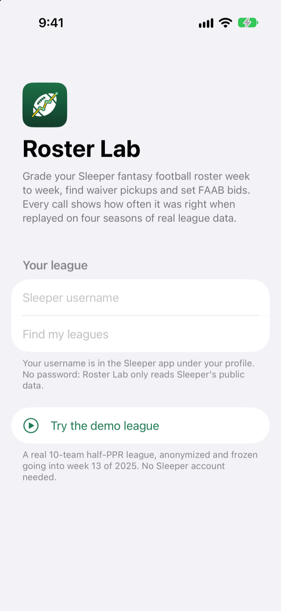
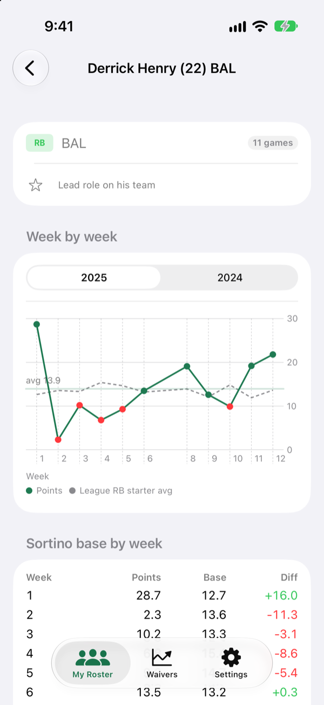
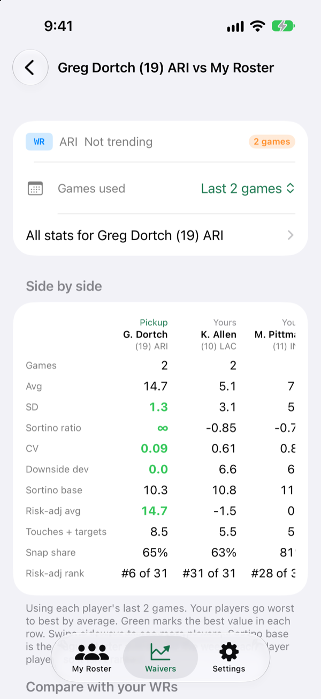
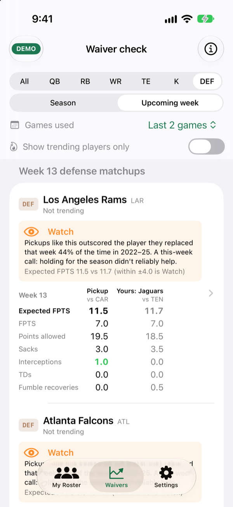

# Roster Lab

**An iOS app that tells a fantasy football manager what to do this week, and how often that advice has been right.**

Roster Lab reads a [Sleeper](https://sleeper.com) league and makes three calls every week: who to start, which waiver pickups are worth a roster spot, and how much FAAB to bid. Next to each call it shows how often a call like it was right when the same rule was replayed on four seasons of a real league. Rules that didn't hold up were cut or downgraded, and the app says so.

[](https://github.com/singhprabhdeep/fantasy-football-my-roster-lab/actions/workflows/tests.yml)
  

<p align="center">
  
  
  
  
</p>

## The problem

Fantasy apps give a manager plenty of numbers: projections, averages, trending adds, injury tags. What they rarely say is which of those numbers to trust, how much, and what to do with them on Wednesday night when waivers run. Managers end up chasing last week's big game, overpaying for a backup who'll be back on the bench in two weeks, or second-guessing a lineup.

**Who it's for:** someone in a competitive Sleeper league who sets a lineup and works the waiver wire every week, and wants a call they can act on in a minute, with the evidence one tap away.

**Jobs it does:**

| When I'm... | Roster Lab tells me... | Backed by |
| --- | --- | --- |
| Setting my lineup | Start or bench each player, with a confidence (Strong / Lean / Toss-up) | Projection-led lineups beat every alternative in all 4 seasons |
| Scanning waivers | Replace, Watch or Don't replace, against my weakest player at that position | Replace calls were right 66–71% of the time, every season |
| Reacting to an injury | Which backup inherits the role, how many touches to expect, and what to bid | 377 games where a starter sat out, and the league's bids on those backups |
| Streaming a defense or kicker | This-week calls from projections, plus an Expected FPTS matchup view | Replace 53–81% depending on season; the app warns where the edge is small |

## What's in the app

| | |
| --- | --- |
|  | **Setup.** Enter a Sleeper username, pick a league. No password: Sleeper's API is public and read-only. Or open the **demo league**: a real 10-team half-PPR league, anonymized and frozen going into week 13 of 2025, so anyone can try the app without an account. |
|  | **My Roster.** Each starter and bench player with this week's projection, season average, touches + targets, a risk-adjusted average and a start/sit call with its historical hit rate. A one-line "do your stats agree?" check sits under each call. The lineup total ranks your team against the league. |
|  | **Player detail.** Week-by-week points against the league's average starter at that position (the "Sortino base"), and every season side by side. |
|  | **Waivers.** Sleeper's trending adds plus the best available players by usage, each compared with your lowest player at the position. Filter by position, by trending only, or by **starter out** (backups whose team's lead RB/WR/TE is injured). |
|  | **Role changes and FAAB.** When a team's lead is Out or on IR, the next man up is tagged *Likely lead* (or *Committee*), with role-adjusted touches and points and a suggested FAAB bid sized to how long the role should last and how much budget you have left. |
|  | **Compare.** The pickup side by side with every player you have at the position, worst to best, on every stat. |
|  | **Defense matchups.** For the upcoming week, an Expected FPTS for every available defense from your league's own data (the defense's average plus how friendly the opponent is). |
|  | **"Why these stats."** Every rule, its four-season hit rate, and the reasoning, inside the app. |

## How it decides, and how I know it works

Every recommendation in the app went through the same loop: define the rule, replay it on past seasons using only what was known before each week, keep it only if it held up, then show the hit rate in the UI. The full results are in [docs/BACKTESTS.md](docs/BACKTESTS.md).

A few results that shaped the product:

- **The fancy metric lost.** I started with the Sortino ratio (return over downside risk, borrowed from finance) as the main ranking. It had almost no link to next week's points (correlation 0.05–0.08 in every season). It survives only as a yes/no flag, *Sortino > 0*, because players above 0 beat a typical starter 48–52% of the time against 39–41% below 0.
- **Projections beat my own blends.** Every blend I tried of Sleeper projections with season averages, recent averages or usage trends did worse than the projection alone, in every season. So start/sit follows the projection, and my stats became a cross-check rather than the decision.
- **Usage beats hot streaks on waivers.** Players flagged by a high recent average dropped 1–2.5 points per game after pickup; players flagged by touches + targets stayed within half a point. Usage leads the waiver card.
- **More data made the app more honest.** Adding 2022 and 2023 lowered several hit rates. The QB swap rule went from 71% to 45% depending on the season, so the app now says it's the least steady call.
- **The league barely pays for backups.** When a starter sat, 79% of the backups on waivers weren't added at all and the median winning bid was $3. FAAB suggestions are sized to that, not to generic advice.

## Run it

Requirements: Xcode 16 or later, iOS 17+ simulator or device.

1. Open `RosterLab.xcodeproj` and run the **RosterLab** scheme on a simulator. Tap **Try the demo league**, or enter your Sleeper username.
2. To install on your own iPhone: copy `Config/Signing.local.xcconfig.example` to `Config/Signing.local.xcconfig` and set your Apple team ID and a bundle ID. That file is git-ignored.

Tests:

```bash
cd RosterLabKit && swift test
```

The suite includes an offline end-to-end run over the bundled demo league. To run against your own league: `ROSTERLAB_LEAGUE=<league id> ROSTERLAB_USER=<username> swift test --filter LiveLeagueTests`.

## How it's built

- **`RosterLabKit/`**: a Swift package with no UI. It holds the Sleeper client with an on-disk cache, league scoring, metrics, start/sit and waiver advisors, the injury/role model and FAAB advice. It's unit-tested and shared by the app and the tests.
- **`RosterLab/`**: the SwiftUI app (iOS 17, `@Observable`). It has no backend and no account; everything runs on the phone against Sleeper's public API.
- **`research/`**: the Python backtests behind every number in the app, plus `fetch_season.py` to download any league's history and rerun them.
- **`scripts/build_demo_league.py`**: builds the anonymized demo snapshot.

More in [docs/ARCHITECTURE.md](docs/ARCHITECTURE.md).

## Limits

- Calibrated on one 10-team, half-PPR, $50 FAAB league (2022–2025). The rules should transfer to similar leagues, but the hit rates are this league's.
- Samples are small in places: FAAB claims on backups (18 in four seasons), kicker calls (a few dozen a season).
- Kicker and defense numbers are noisy; the app labels them that way.
- Sleeper's weekly stats and trending endpoints aren't officially documented. All calls live in one file (`SleeperClient.swift`) so a change on their side is a one-file fix.
- The demo league's injuries are rebuilt from box scores (who sat out that week), because Sleeper doesn't keep historical injury news.

## Roadmap

- Calibrate per league: rerun the backtests on the user's own league history inside the app.
- Trade evaluator using the same risk-adjusted numbers.
- Push notifications when a starter on your roster, or a lead on any team, is ruled out.
- Playoff-schedule strength for weeks 15–17.

---

Not affiliated with Sleeper. Uses Sleeper's public, read-only API. MIT licensed.
