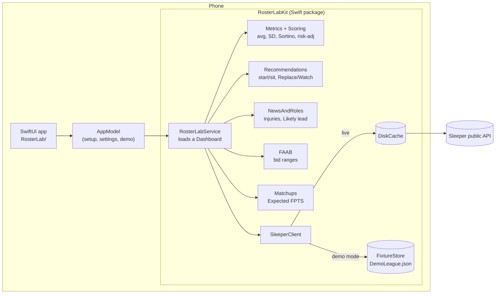

# Architecture

Roster Lab is an iPhone app with no backend. It calls Sleeper's public, read-only API, caches responses on the phone and does all the math on the device.

## Layers

**`RosterLab/` (SwiftUI app).** Views and one `@Observable` `AppModel` that holds the user's setup (Sleeper username and league, or demo mode), settings, and the loaded `Dashboard`. Views never call the network; they read the dashboard and ask the kit for advice.

**`RosterLabKit/` (Swift package, no UI).** Everything that can be tested without a phone:

| File | Job |
| --- | --- |
| `SleeperClient.swift` | Every Sleeper call in one place, so an API change is a one-file fix. Finished weeks are cached permanently; rosters for 30 seconds; injuries every 2 hours. Falls back to the cache when offline. |
| `FixtureStore.swift` | Demo mode: answers the same API paths from a bundled JSON snapshot, so the demo runs the real code path with no network. |
| `Scoring.swift`, `Metrics.swift` | League-specific fantasy points from raw stats (matches Sleeper's own scores exactly), and per-season metrics against a weekly "base": the average league starter at that position. |
| `RosterLabService.swift` | Loads a league and its previous seasons, builds reports for every player, the waiver list, league lineup totals and roles, into one `Dashboard`. |
| `Recommendations.swift` | Start/sit from projections with a calibrated confidence; Replace / Watch / Don't replace for waivers and for K/DEF streaming. Hit rates from the backtests live next to each rule. |
| `NewsAndRoles.swift` | Injury statuses, each team's lead RB/WR/TE by usage, and who inherits the role when the lead is out. |
| `FAAB.swift` | Bid ranges for those backups, from the league's own bidding history. |
| `Matchups.swift` | Defense Expected FPTS from the schedule and what earlier defenses scored against each offense. |

**`research/` (Python).** The backtests that produced every rule and hit rate. Each one replays a season week by week using only data available before that week. `fetch_season.py` downloads any league's history so they can be rerun.

**`scripts/build_demo_league.py`.** Builds `RosterLab/DemoLeague.json`: a real league's season frozen at one week, with every manager renamed and league ids replaced. Injuries are rebuilt from box scores, since Sleeper doesn't keep historical injury news.

## Choices worth calling out

- **No backend, no login.** Sleeper's data is public and read-only, so there's nothing to secure and nothing to host. The trade-off is that per-user calibration has to run on the device (see the roadmap).
- **Kit vs app split.** The recommendation logic is plain Swift with 38 unit tests, including an offline end-to-end run on the demo league. The UI stays thin.
- **One client file.** Two of the endpoints the app depends on (weekly stats, trending) aren't in Sleeper's official docs. Isolating them limits the blast radius if they change.
- **Demo through the real pipeline.** The demo isn't mock UI; it's recorded API responses served through the same client, so it exercises the same code users run.
- **Signing kept out of the repo.** `Config/Signing.xcconfig` holds placeholders; a git-ignored `Signing.local.xcconfig` carries a developer's own team and bundle id.

## Metrics

Each season is computed separately. A week counts only if the player played, scored with that season's league settings.

| Metric | Formula |
| --- | --- |
| Weekly base `T(pos, w)` | Average points of every league starter at that position in week `w` (FLEX counts by real position) |
| Avg `μ` | Mean of weekly points |
| SD `σ` | Sample standard deviation (2+ games) |
| CV | `σ / μ` (blank when `μ < 2`) |
| Downside dev `DD` | `sqrt(mean(min(0, x_w − T_w)²))` |
| Sortino ratio | `mean(x_w − T_w) / DD` (∞ when no week fell below the base) |
| Risk-adj avg | `μ − k × DD`, `k = 1` by default (Settings) |
| Touches + targets | Carries + targets per game (RB/WR/TE) |
| Snap share | Offensive snaps ÷ team offensive snaps |
